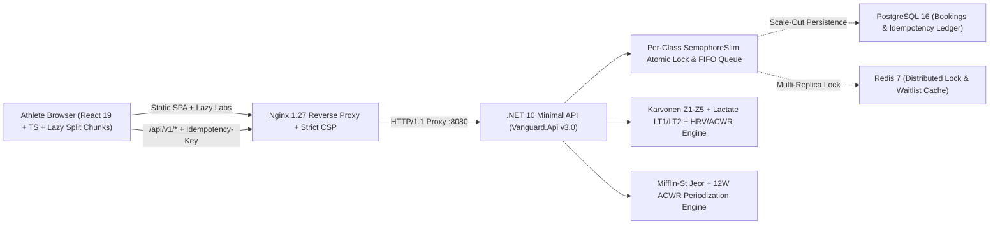

# VANGUARD PERFORMANCE CLUB v3.0

**Equinox × WHOOP Sports-Science & Autonomic Readiness Platform — Full-Stack `.NET 10` Clean Architecture + React 19 Monorepo** — engineered by **TVT Studio (Truong Van Tinh)**.

- **Live Frontend Showcase:** https://tvt987.github.io/vanguard-fitness/
- **OpenAPI 3.1 Specification (v3.0.0):** [`docs/openapi.yaml`](./docs/openapi.yaml)
- **Architecture Decision Records:**
  - [`ADR-001` — Atomic Class Capacity Lock, Idempotency & FIFO Waitlist Promotion](./docs/ADR-001-Atomic-Class-Capacity-Lock-And-FIFO-Waitlist-Promotion.md)
  - [`ADR-002` — 12-Week Mesocycle Periodization, ACWR Injury Guard & Frontend Code-Splitting](./docs/ADR-002-12Week-Mesocycle-Periodization-And-ACWR-Guard.md)

---

## Full-Stack System Architecture (v3.0)



---

## Core Engineering Highlights (v3.0 Masterwork)

### 1. Polarized Heart-Rate Zone, Blood Lactate Curve & Autonomic HRV Readiness Lab (`PerformanceReadinessLab.tsx` + `readinessEngine.ts` + `.NET 10` Parity)
- **Karvonen HR Reserve (`Z1–Z5`) & Seiler 80/20 Polarized Split**:
  - Configurable Athlete Age (`18–75`), Resting HR (`38–90 bpm`), Max HR (auto Tanaka `208 − 0.7 × Age` or lab custom override `130–225`), and Athlete Tier (`Executive Wellness` / `Hybrid Competitor` / `Marathon Elite`).
  - Computes strict non-overlapping **Karvonen 5-Zone BPM Bands (`50–60%`, `60–70%`, `70–80%`, `80–90%`, `90–100%` HRR)**, **Uth–Sørensen VO₂ Max (`15.3 × MaxHR / RestingHR`)** with age-adjusted percentile rating, and exact **80/20 Polarized Weekly Minute Splits** (`240m` / `360m` / `540m`).
- **Animated SVG Blood Lactate Curve (`mmol/L` vs `% HRR`)**:
  - Closed-form exponential physiological lactate modeling passing accurately through **LT1 Aerobic Threshold (`2.0 mmol/L`)** and **LT2 Anaerobic Turnpoint (`4.0 mmol/L`)** with tier-calibrated rightward aerobic shift and interactive curve inspection.
- **Autonomic HRV (`rMSSD`) & ACWR Readiness Auto-Prescriber**:
  - Computes **ACWR Ratio (`Acute / Chronic`)** across 4 sports-science bands (`<0.80 Undertrained`, `0.80–1.30 Optimal Sweet Spot`, `1.31–1.50 Caution`, `>1.50 High Injury Risk`), **HRV Z-Delta %**, **Composite Readiness Score (`0–100`)** with physiological safety caps, and deterministic **Daily Session Auto-Prescription** (`GREEN Peak Output` -> Full Threshold Intervals, `AMBER Modify` -> Cap at Z2 Aerobic Base, `RED Recover` -> 35m Mobility & Cold Plunge).
  - Includes a dual-axis **7-Day SVG HRV & ACWR Telemetry Sparkline**, 3 instant athlete presets (*Peak Race Taper*, *Executive Jetlag Recovery*, *Overreaching Red Alert*), and UTF-8 BOM `.CSV` export.

### 2. Editorial Performance Club Suite & Swiss Daylight / Obsidian Lab Modes (`src/`)
- **12-Week Periodized Mesocycle & Workout Split Lab (`PeriodizationBuilderLab.tsx` + `periodizationEngine.ts`)**: 3-mesocycle block generator (`W1–W12`), W4/W8/W12 deloads (`-40%`), rolling ACWR guard (`<= 1.35`), plate-rounded (`2.5 kg`) barbell splits, and `.CSV`/`.MD` exports.
- **Mifflin-St Jeor Metabolic Lab & 12-Week Trajectory Simulator**: Exact resting metabolic rate, 5-tier TDEE multipliers, goal-calibrated macro splits, hydration/electrolyte dosing, and interactive SVG trajectory.
- **Weekly Timetable, PT Matcher, Techcombank VietQR & A4 Printable Blueprint**: Live slot locking, automatic waitlist enrollment, `.ics` export, bilingual `EN/VI`, `VNĐ/USD`, **Swiss Performance Daylight / Obsidian Lab Mode** toggle, Strict CSP + `Referrer-Policy`, and zero UI emojis.
- **Vite `manualChunks` + `React.lazy` Code-Splitting**: Main entry JS kept lean at **`57.31 kB`** raw (`18.33 kB` gzip) while lazy-loading all heavy sports-science labs on demand.

### 3. `.NET 10` Atomic Capacity Lock, Readiness & Metabolic API (`backend/`)
- Strict `.NET 10` (`TreatWarningsAsErrors=true`, `Nullable=enable`) cleanly layered into `Vanguard.Domain`, `Vanguard.Api`, and `Vanguard.Api.Tests`.
- **Exact Backend Parity (`POST /api/v1/metabolic/readiness-zones`)**: Clean Architecture `ReadinessZonesService` mirroring `readinessEngine.ts` formulas (`MidpointRounding.AwayFromZero`) with full RFC 7807 `400 Bad Request` domain validation.
- **Per-Class Fine-Grained Locking (`SemaphoreSlim`) + SHA-256 Idempotency + Automatic FIFO Waitlist Promotion**: Under a **10-way concurrent last-spot race (`Task.WhenAll`)**, strictly `1 × 201 Created (CONFIRMED)` wins while `9 × 202 Accepted (WAITLISTED)` receive unique sequential FIFO positions `#1..#9`.

---

## REST API Surface (`docs/openapi.yaml` · v3.0.0)

| Method | Route | Behavior & Status Codes |
| --- | --- | --- |
| `GET` | `/health` | `200 OK` — Service health (`v3.0.0`), .NET runtime version, active studio class count |
| `GET` | `/api/v1/classes` | `200 OK` — Live studio schedule (`enrolledCount`, `capacity`, `waitlistCount`, `coach`, `studioZone`); optional `?discipline=` |
| `GET` | `/api/v1/classes/{classId}` | `200 OK` / `404` — Live class summary + ordered FIFO waitlist queue |
| `POST` | `/api/v1/classes/{classId}/book` | Requires `Idempotency-Key` header. `201 Created` (`CONFIRMED`), `202 Accepted` (`WAITLISTED`), `200 OK` (idempotent replay), `400`, `404`, `409` |
| `DELETE` | `/api/v1/classes/{classId}/bookings/{bookingId}` | `200 OK` / `404` — Cancels booking; atomically promotes FIFO `#1` to `CONFIRMED` & shifts remaining queue |
| `POST` | `/api/v1/metabolic/analyze` | `200 OK` / `400` — Mifflin-St Jeor BMR, TDEE, macros (`cut / recomp / lean-bulk`) & 12-week ACWR-guarded mesocycle projection |
| `POST` | `/api/v1/metabolic/readiness-zones` | `200 OK` / `400` — Karvonen Z1–Z5 BPM bands, Uth–Sørensen VO₂ Max, LT1/LT2 blood lactate curve, 80/20 polarized split, HRV/ACWR readiness score, 7-day telemetry & `GREEN / AMBER / RED` prescription |

---

## Quick Start

### Option A: Full-Stack Docker Compose (`web` + `api` + `postgres` + `redis`)
```bash
docker compose up --build
# Frontend + Nginx Reverse Proxy: http://localhost:3000
# .NET 10 Minimal API direct:     http://localhost:8080/health
```

### Option B: Local Native Development & Tests
```bash
# 1. Frontend unit tests & production split build
npm ci
npm test
npm run build

# 2. .NET 10 Backend compile & integration/concurrency/readiness test suite
dotnet test backend/Vanguard.sln

# 3. Validate OpenAPI 3.1 contract
python -c "import yaml; yaml.safe_load(open('docs/openapi.yaml', encoding='utf-8')); print('OPENAPI_OK')"

# 4. Run .NET 10 API locally (port 5000/8080)
dotnet run --project backend/src/Vanguard.Api/Vanguard.Api.csproj
```

---

## Bundle Code-Splitting Verification (v3.0)

| Artifact | v1.0 Monolith | v3.0 Code-Split | Note |
| --- | --- | --- | --- |
| Main Entry JS (`index-*.js`) | `312.40 kB` (`91.16 kB` gz) | **`57.31 kB` (`18.33 kB` gz)** | **-81.7% (`< 100 kB` budget)** |
| Vendor React Chunk (`react-*.js`) | bundled | `185.31 kB` (`58.36 kB` gz) | Cached independently |
| Pure Engines Chunk (`engines-*.js`) | bundled | `56.39 kB` (`19.67 kB` gz) | Shared pure TS domain engines |
| `PerformanceReadinessLab` (lazy) | — | `36.43 kB` (`7.63 kB` gz) | Loaded via `React.lazy` |
| `PeriodizationBuilderLab` (lazy) | — | `22.86 kB` (`5.26 kB` gz) | Loaded via `React.lazy` |
| `MembershipSection` (lazy) | bundled | `20.70 kB` (`4.78 kB` gz) | Loaded via `React.lazy` |
| `MetabolicLabSection` (lazy) | bundled | `18.63 kB` (`3.79 kB` gz) | Loaded via `React.lazy` |
| `TimetableSection` (lazy) | bundled | `10.17 kB` (`2.79 kB` gz) | Loaded via `React.lazy` |

---

## 4-Gate Production Verification Matrix (v3.0)

| Gate | Suite / Check | Result |
| --- | --- | --- |
| **Gate 1 — Frontend Unit Tests** | `npm test` (Vitest) | **79 / 79 passed** (5 suites: +27 new `readinessEngine` Karvonen/VO₂/Lactate/HRV/ACWR tests) |
| **Gate 2 — TypeScript + Split Build** | `npm run build` (`tsc -b && vite build`) | **0 errors**, entry JS **`57.31 kB`** (`18.33 kB` gz, `< 100 kB` target) |
| **Gate 3 — `.NET 10` Backend & Readiness API** | `dotnet test backend/Vanguard.sln` | **52 / 52 passed**, **0 warnings** (`TreatWarningsAsErrors=true`, +23 new readiness/zones tests) |
| **Gate 4 — Headless Playwright E2E** | `1440×900` Desktop & `390×844` Mobile | **0 console errors, 0 page errors, 0 failed requests, 0px overflow**, Daylight & Obsidian Lab themes, all 3 presets, LT1/LT2 lactate curve & Strict CSP verified |
