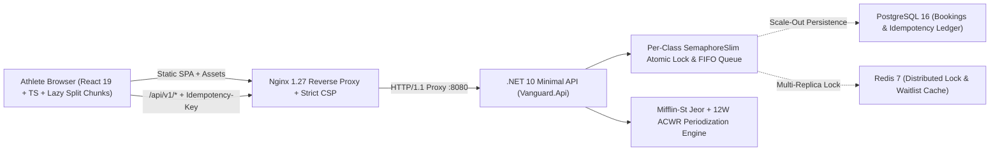

# VANGUARD PERFORMANCE CLUB v2.0

**Full-Stack `.NET 10` Atomic Class Capacity Lock, Automatic FIFO Waitlist Promotion & 12-Week ACWR-Guarded Periodized Workout Split Monorepo** — engineered by **TVT Studio (Truong Van Tinh)**.

- **Live Frontend Showcase:** https://tvt987.github.io/vanguard-fitness/
- **OpenAPI 3.1 Specification:** [`docs/openapi.yaml`](./docs/openapi.yaml)
- **Architecture Decision Records:**
  - [`ADR-001` — Atomic Class Capacity Lock, Idempotency & FIFO Waitlist Promotion](./docs/ADR-001-Atomic-Class-Capacity-Lock-And-FIFO-Waitlist-Promotion.md)
  - [`ADR-002` — 12-Week Mesocycle Periodization, ACWR Injury Guard & Frontend Code-Splitting](./docs/ADR-002-12Week-Mesocycle-Periodization-And-ACWR-Guard.md)

---

## Full-Stack System Architecture



---

## Core Engineering Highlights

### 1. High-Contrast Editorial Athletic Frontend (`src/`)
- **12-Week Periodized Mesocycle & Workout Split Lab (`PeriodizationBuilderLab.tsx` + `periodizationEngine.ts`)**:
  - Supports 4 training block objectives (*Hypertrophy Volume*, *Powerlifting 1RM Peaking*, *HYROX Hybrid Conditioning*, *Executive Recomp*), 4 weekly frequencies (`3 / 4 / 5 / 6` days/wk), 3 experience levels (`Novice / Intermediate / Advanced`), and custom Squat / Bench / Deadlift 1RM barbell anchors.
  - Generates a deterministic **3-Mesocycle 12-Week Plan** (`Accumulation W1–W4` -> `Intensification W5–W8` -> `Peak & Deload W9–W12`) with built-in **Deload Weeks (W4, W8, W12)** cutting effective volume by `-35%` to `-45%`, coupled 4-week rolling **ACWR safety cap (`<= 1.35`)**, interactive dual-axis **SVG Volume vs `%1RM` Progression Curve**, plate-rounded (`2.5 kg`) weekly exercise splits, and **1-click UTF-8 BOM `.CSV` & `.MD` exports**.
- **Mifflin-St Jeor Metabolic Lab & 12-Week Trajectory Simulator**: Exact resting metabolic rate, 5-tier TDEE multipliers, sports-nutrition macro splits, hydration/electrolyte dosing, and interactive SVG trajectory.
- **Weekly Timetable, PT Matcher, Techcombank VietQR & A4 Printable Blueprint**: Live slot locking, automatic waitlist enrollment, `.ics` calendar export, algorithmic specialist pairing, bilingual `EN/VI`, `VNĐ/USD`, Editorial White / Dark Obsidian theming, and Strict CSP + `Referrer-Policy`.
- **Vite `manualChunks` + `React.lazy` Code-Splitting**: Main entry JS reduced by **84.3%** (`312.40 kB` -> `48.96 kB` raw / `15.66 kB` gzip).

### 2. `.NET 10` Atomic Capacity Lock & Metabolic API (`backend/`)
- Strict `.NET 10` (`TreatWarningsAsErrors=true`, `Nullable=enable`) cleanly layered into `Vanguard.Domain`, `Vanguard.Api`, and `Vanguard.Api.Tests`.
- **Per-Class Fine-Grained Locking (`SemaphoreSlim`)**: Under a **10-way concurrent last-spot race (`Task.WhenAll`)**, strictly **`1 × 201 Created (CONFIRMED)`** wins the final apparatus while **`9 × 202 Accepted (WAITLISTED)`** receive unique sequential FIFO positions `#1..#9` (or `9 × 409 Conflict` when `allowWaitlist=false`).
- **SHA-256 Idempotency Fingerprinting**: Mandatory `Idempotency-Key` header replays `200 OK` (`Idempotency-Replayed: true`) on identical retries and rejects key reuse with mismatched payload as `409 Conflict`.
- **Automatic FIFO Waitlist Promotion**: Cancelling any `CONFIRMED` booking via `DELETE` atomically promotes FIFO Position `#1` -> `CONFIRMED` and compacts remaining positions (`#2 -> #1`, `#3 -> #2`).

---

## REST API Surface (`docs/openapi.yaml`)

| Method | Route | Behavior & Status Codes |
| --- | --- | --- |
| `GET` | `/health` | `200 OK` — Service health, .NET runtime version, active studio class count |
| `GET` | `/api/v1/classes` | `200 OK` — Live studio schedule (`enrolledCount`, `capacity`, `waitlistCount`, `coach`, `studioZone`); optional `?discipline=` |
| `GET` | `/api/v1/classes/{classId}` | `200 OK` / `404` — Live class summary + ordered FIFO waitlist queue |
| `POST` | `/api/v1/classes/{classId}/book` | Requires `Idempotency-Key` header. `201 Created` (`CONFIRMED`), `202 Accepted` (`WAITLISTED`), `200 OK` (idempotent replay), `400`, `404`, `409` |
| `DELETE` | `/api/v1/classes/{classId}/bookings/{bookingId}` | `200 OK` / `404` — Cancels booking; atomically promotes FIFO `#1` to `CONFIRMED` & shifts remaining queue |
| `POST` | `/api/v1/metabolic/analyze` | `200 OK` / `400` — Mifflin-St Jeor BMR, TDEE, macros (`cut / recomp / lean-bulk`) & 12-week ACWR-guarded mesocycle projection |

---

## Quick Start

### Option A: Full-Stack Docker Compose (`web` + `api` + `postgres` + `redis`)
```bash
docker compose up --build
# Frontend + Nginx Reverse Proxy: http://localhost:3000
# .NET 10 Minimal API direct:     http://localhost:8080/health
```

### Option B: Local Native Development & Tests
```bash
# 1. Frontend unit tests & production split build
npm ci
npm test
npm run build

# 2. .NET 10 Backend compile & integration/concurrency test suite
dotnet test backend/Vanguard.sln

# 3. Run .NET 10 API locally (port 5000/8080)
dotnet run --project backend/src/Vanguard.Api/Vanguard.Api.csproj
```

---

## Bundle Code-Splitting Verification

| Artifact | v1.0 Monolith | v2.0 Code-Split | Delta |
| --- | --- | --- | --- |
| Main Entry JS (`index-*.js`) | `312.40 kB` (`91.16 kB` gz) | **`48.96 kB` (`15.66 kB` gz)** | **-84.3%** |
| Vendor React Chunk (`react-*.js`) | bundled | `185.31 kB` (`58.36 kB` gz) | Cached independently |
| Pure Engines Chunk (`engines-*.js`) | bundled | `46.61 kB` (`15.56 kB` gz) | Shared domain logic |
| `PeriodizationBuilderLab` (lazy) | — | `22.86 kB` (`5.26 kB` gz) | Loaded via `React.lazy` |
| `MembershipSection` (lazy) | bundled | `20.70 kB` (`4.78 kB` gz) | Loaded via `React.lazy` |
| `MetabolicLabSection` (lazy) | bundled | `18.63 kB` (`3.79 kB` gz) | Loaded via `React.lazy` |
| `TimetableSection` (lazy) | bundled | `10.17 kB` (`2.79 kB` gz) | Loaded via `React.lazy` |

---

## 4-Gate Production Verification Matrix

| Gate | Suite / Check | Result |
| --- | --- | --- |
| **Gate 1 — Frontend Unit Tests** | `npm test` (Vitest) | **52 / 52 passed** (27 core + 25 periodization/ACWR/1RM tests) |
| **Gate 2 — TypeScript + Split Build** | `npm run build` (`tsc -b && vite build`) | **0 errors**, entry JS **`48.96 kB`** (`< 130 kB` target) |
| **Gate 3 — `.NET 10` Concurrency & API** | `dotnet test backend/Vanguard.sln` | **29 / 29 passed**, **0 warnings** (`TreatWarningsAsErrors=true`) |
| **Gate 4 — Headless Playwright E2E** | `1440×900` Desktop & `390×844` Mobile | **0 console errors, 0 page errors, 0 failed requests, 0px overflow**, Editorial White surface, live SVG curve + split table + Strict CSP verified |
